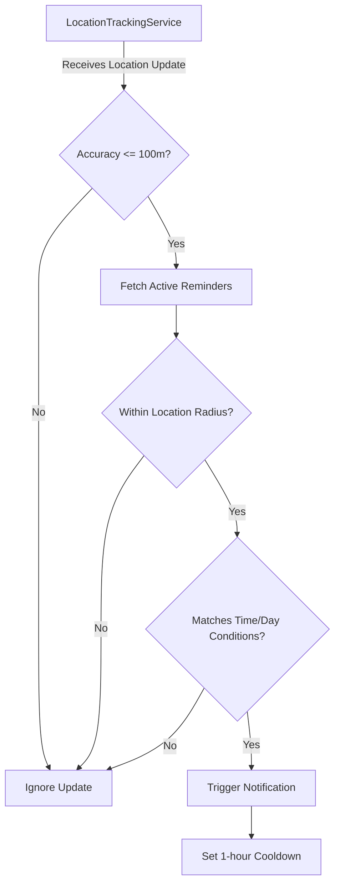
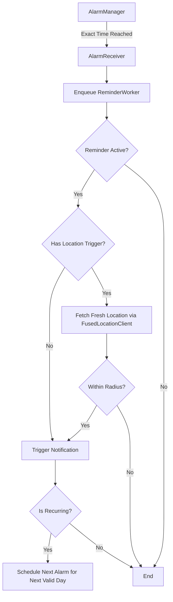

# Location Reminder App

An Android application that helps you remember tasks based on your physical location, the time of day, and specific days of the week. 

## For Users: What It Does

Location Reminder ensures you never forget a task when you arrive at a specific place or at a specific time. 

### Key Features
*   **Location-Based Triggers**: Select a location on a map (e.g., "Grocery Store", "Office") and set a radius. The app will notify you when you enter that area.
*   **Time & Date Triggers**: Set a specific time of day for your reminder.
*   **Recurring Reminders**: Choose specific days of the week (e.g., every Monday and Wednesday) for a reminder to repeat.
*   **Combined Triggers**: Combine location and time! (e.g., "Remind me to submit my timesheet when I am at the Office AND it is 5:00 PM").
*   **Share Integration**: Share a location directly from apps like Google Maps or Organic Maps to the Location Reminder app to quickly create a new saved location.
*   **Notification Management**: Defer a reminder (snooze for 10 minutes) or dismiss it. One-time reminders automatically deactivate upon dismissal.

---

## For Developers: How It Works

The app is built using modern Android development practices, leveraging **Kotlin**, **Jetpack Compose** for the UI, **Room** for local database persistence, and **osmdroid** for map rendering.

### Core Architecture (MVVM)
*   **UI Layer**: Jetpack Compose screens (`HomeScreen`, `MapScreen`, `AddEditReminderScreen`).
*   **ViewModel Layer**: `ReminderViewModel` and `LocationViewModel` manage UI state and interact with the repository.
*   **Data Layer**: `AppRepository` abstracts the Room database DAOs (`LocationDao`, `ReminderDao`).

### 1. Location Tracking Logic
Location tracking is handled by a Foreground Service (`LocationTrackingService`) to ensure the app can monitor geofences even when closed. It uses the `FusedLocationProviderClient` to get location updates.

To preserve battery and avoid false positives:
*   Updates are requested with a minimum displacement of 50 meters.
*   Updates with an accuracy worse than 100 meters are ignored.

### 2. Time-Based Alarm Logic
For time-specific triggers (e.g., exactly 12:00 PM), relying solely on location updates is insufficient because the device might be stationary (and thus not receiving location updates due to the 50m displacement threshold) and in Doze mode.

To solve this, the app uses **AlarmManager** (`setExactAndAllowWhileIdle`) paired with a `BroadcastReceiver` (`AlarmReceiver`) and **WorkManager** (`ReminderWorker`).

When the exact time arrives, the worker wakes up and actively polls the current location to verify if the user is *currently* at the target location before firing the notification.

### 3. Shared Location Handling
The `MainActivity` includes an `<intent-filter>` for `ACTION_SEND` with `text/plain`. 
When a user shares a location from another map app, `MainActivity` parses the shared text (extracting latitude, longitude, and name from standard `geo:` URIs or map URLs) and passes it to the Compose Navigation graph. The `MapScreen` then consumes these arguments to center the map and pre-fill the location name.

### Database Schema
*   **LocationEntity**: `id`, `name`, `latitude`, `longitude`, `radius`
*   **ReminderEntity**: `id`, `title`, `description`, `locationId` (Foreign Key), `timeOfDay`, `recurringDays` (List of Calendar days), `specificDate`, `isDeferred`, `isActive`, `isRecurring`.
    *   *Note: `recurringDays` uses a Room `@TypeConverter` to serialize the List of Integers to a JSON string.*
